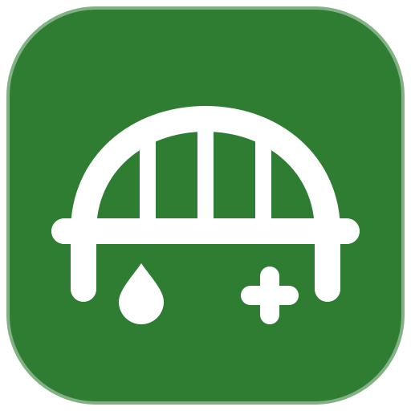

<p align="center"></p>

# Yazio Köprüsü

Yazio'daki yemekleri (kalori, protein, karbonhidrat, yağ, öğün) ve günlük suyu **Health Connect'e yazan** küçük, kişisel bir Android uygulaması.
Health Connect'ten okuyan uygulamalar Yazio verisine bu köprü üzerinden ulaşır.

- **Play'e çıkmaz:** Yazio'nun resmî veri arayüzü yok; topluluk projelerinin kullandığı resmî olmayan API kullanılır. Yazio değiştirirse eşitleme durabilir.
- **Eşitleme:** uygulama açılınca, "Şimdi eşitle" düğmesiyle (bugün / son 7 / son 30 gün) ve arka planda 6 saatte bir (WorkManager, internet varken, en fazla 7 gün; ekrandan kapatılabilir).
- **Çift kayıt yok:** her yemek `clientRecordId = yazio-<Yazio kimliği>` ile yazılır; yeniden eşitlemede güncellenir, Yazio'dan silinen yemek Health Connect'ten de silinir.
- **İzinler:** yalnız beslenme ve su **yazma**. Okuma izni istenmez.
- **Gizlilik:** parola saklanmaz; Yazio oturum anahtarı Android Keystore ile şifreli tutulur. Veri yalnız Yazio ile telefon arasında dolaşır.

## Derleme

```bash
cd android
./gradlew :app:assembleRelease   # app/build/outputs/apk/release/app-release.apk (debug anahtarıyla imzalı)
```
